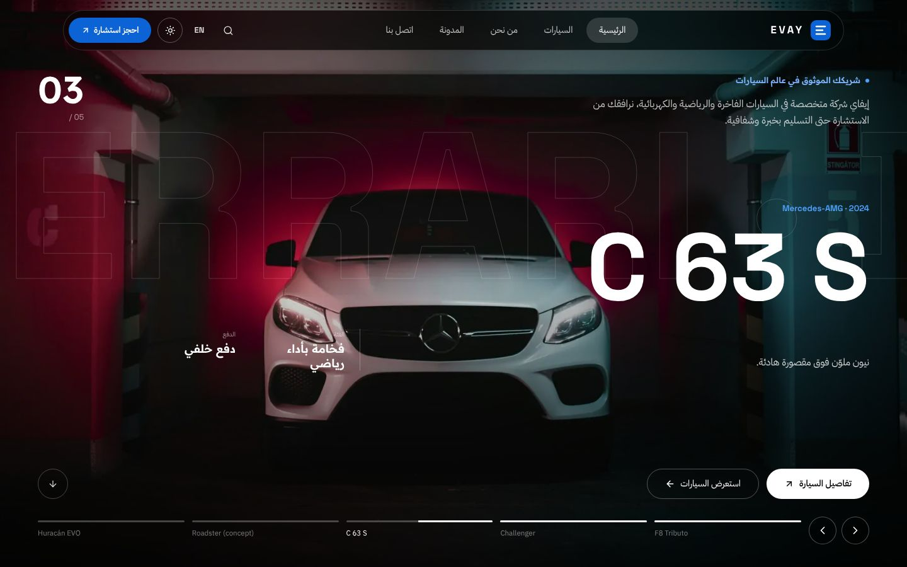
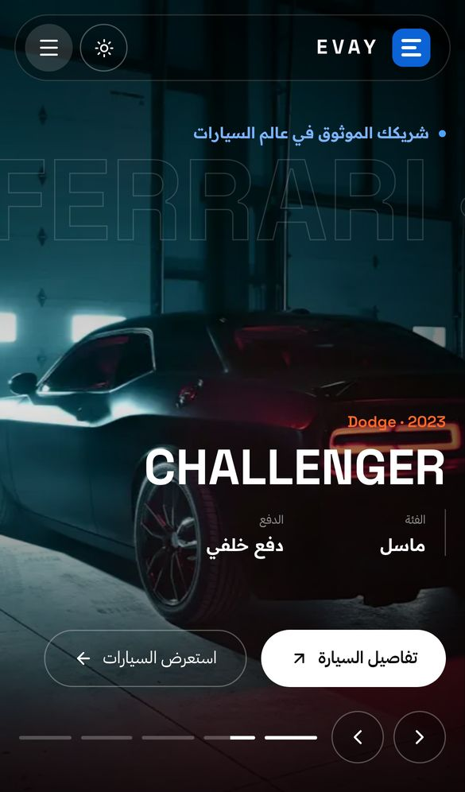
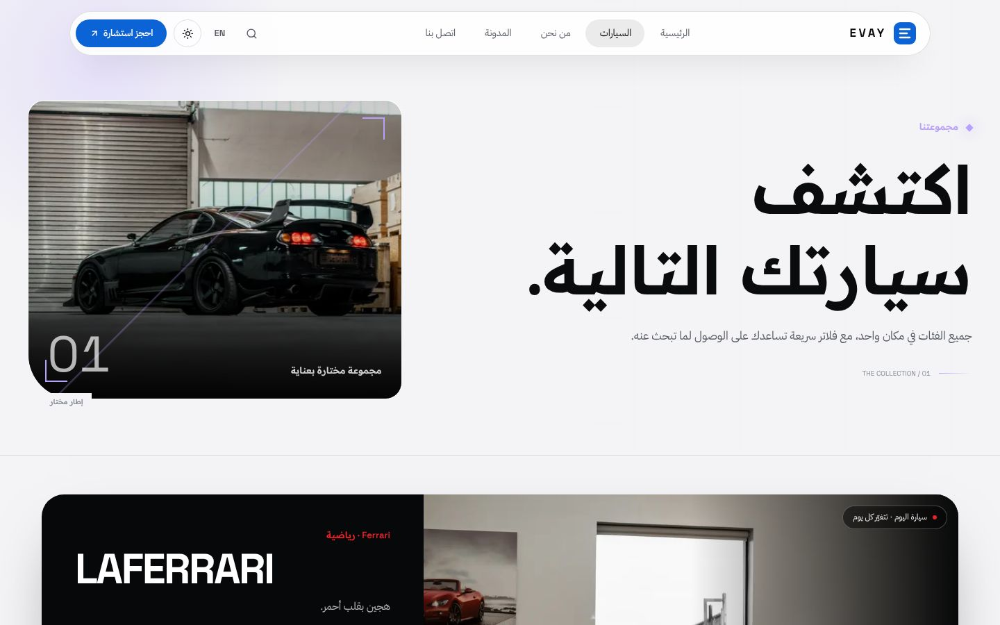

<div align="center">

# EVAY — Automotive Showcase

### A bilingual (AR / EN) car showcase with scroll-driven animation and Three.js scenes

A Next.js 16 company-profile and showroom website for a fictional premium car dealer called "EVAY". It combines a WebGL hero carousel, a procedural 3D wheel that comes apart as you scroll, 15 vehicle pages, a blog, and a printable company profile.

[](https://nextjs.org)
[](https://react.dev)
[](https://www.typescriptlang.org)
[](https://tailwindcss.com)
[](https://threejs.org)
[](https://gsap.com)
[](https://motion.dev)
[](https://animejs.com)
[](https://lenis.darkroom.engineering)
<br>
[](https://car-psi-inky.vercel.app)

**[Live demo](https://car-psi-inky.vercel.app)** ·
**[Portfolio](https://new-portfolio-ashy-xi.vercel.app/)** ·
**[LinkedIn](https://www.linkedin.com/in/eslamraafat-dev/)** ·
**[Email](mailto:eslamraafat736@gmail.com)**

<br>



</div>

<table>
  <tr>
    <td width="33%"></td>
    <td width="67%"></td>
  </tr>
  <tr>
    <td align="center"><sub>Mobile (iPhone 13), Arabic RTL</sub></td>
    <td align="center"><sub>Explore page (<code>/explore</code>)</sub></td>
  </tr>
</table>

---

## Contents

- [Overview](#overview)
- [Features](#features)
- [Tech stack](#tech-stack)
- [Pages](#pages)
- [Project structure](#project-structure)
- [Getting started](#getting-started)
- [Deployment](#deployment)
- [Author](#author)

## Overview

This is a **personal project**. EVAY is a made-up brand: the company copy, testimonials, phone number and email (`*.example`) are **placeholders**. The car photos come from Unsplash (see `scripts/download-assets.mjs`).

I built it to push motion and WebGL work in a modern Next.js stack:

- **Next.js 16** with Cache Components, the React Compiler and Turbopack,
- custom **Three.js** scenes (GLSL shaders and procedural geometry) that mount only when they come near the viewport,
- scroll-driven storytelling with **GSAP**, smooth scrolling with **Lenis**, and micro-interactions with **Framer Motion** and **Anime.js**,
- a site that defaults to **Arabic (RTL)** and switches fully to English (LTR).

## Features

### 3D and motion

- **WebGL hero carousel.** Slide changes use a custom shader transition (`HeroCarouselScene.tsx`).
- **Procedural performance wheel** (`WheelScene.tsx`): tyre, ten spokes, drilled disc and caliper, built from Three.js primitives with no model files. It spins with the page and pulls apart into an exploded view mid-scroll.
- **Interactive globe** on the contact page, marking the cities the brand serves.
- **Shader-based image effects** on the car and page headers.
- **Animation details:**
  - kinetic headings and a velocity marquee,
  - a horizontal gallery,
  - an animated dot grid,
  - magnetic buttons and a cursor aura,
  - a scroll progress bar.
- The wheel and globe scenes respect `prefers-reduced-motion`.

### Vehicles

- **15 vehicles** in four categories (sports, luxury, SUV, electric), each with its own statically generated page at `/cars/[slug]`.
- **Vehicle pages** include:
  - a hero,
  - a spec band,
  - animated **performance gauges** (half-circle dials with a count-up),
  - highlights and a "day with the car" story,
  - a launch sequence,
  - a sticky buy bar,
  - a link to the next car.
- **Explore page:** car of the day, category explorer and the full collection.

### Content and UX

- **Bilingual AR / EN.** Arabic and RTL are the default. The choice is saved in `localStorage` and applied before first paint by an inline script, along with the light/dark theme.
- **Command palette.** Press `Ctrl/⌘ + K` or `/` to open it. It searches pages and car models and works with the keyboard.
- **Blog:** 6 articles, with statically generated post pages.
- **Company profile** at `/profile`: an A4 layout you can print, plus downloadable Arabic and English PDFs, generated by `scripts/generate-profile-pdf.mjs` with Playwright.
- **Contact form** that validates the input and opens a pre-filled email (`mailto:`), so no backend is needed.
- An intro loader that shows only once per session, a back-to-top button and a custom 404 page.
- `sitemap.ts` and `robots.ts`. `/electric` and `/performance` redirect permanently to `/explore`.

## Tech stack

| Layer | Tools |
| --- | --- |
| Framework | Next.js 16.4 (App Router, Cache Components, React Compiler, Turbopack) |
| UI library | React 19.3 |
| Language | TypeScript 5 |
| Styling | Tailwind CSS 4 |
| 3D | Three.js r186 (custom GLSL shaders, procedural geometry) |
| Animation | GSAP 3.15 (+ `@gsap/react`), Framer Motion 14, Anime.js 4.5 |
| Smooth scroll | Lenis 1.3 |
| Icons | lucide-react |
| Fonts | `next/font/google`: Inter, Space Grotesk, IBM Plex Sans Arabic, Readex Pro |
| Hosting | Vercel |

## Pages

| Route | Page |
| --- | --- |
| `/` | Home: hero carousel, intro, vision and mission, services, 3D wheel, gallery, process, partners, testimonials, FAQ |
| `/explore` | Car of the day, categories, full collection |
| `/cars/[slug]` | Vehicle detail (15 pages) |
| `/about` | Company story, timeline, team, awards |
| `/blog`, `/blog/[slug]` | Blog list and articles |
| `/contact` | Contact form, details, 3D globe |
| `/profile` | Printable company profile with PDF downloads |

## Project structure

```text
.
├── scripts/
│   ├── download-assets.mjs        # fetches the Unsplash photos into public/media
│   └── generate-profile-pdf.mjs   # Playwright: /profile → public/evay-company-profile-{ar,en}.pdf
├── public/media/                  # car photos (hero, gallery, details)
└── src/
    ├── app/                       # routes, layout, sitemap.ts, robots.ts, not-found
    ├── components/
    │   ├── automotive/            # home and about sections, navbar, footer, smooth scroll
    │   ├── car/                   # vehicle page sections (gauges, spec band, buy bar…)
    │   ├── three/                 # HeroCarouselScene, WheelScene, Globe, ShaderImage
    │   ├── pages/                 # page views (Explore, CarDetail, Blog, Contact, Profile…)
    │   └── ui/                    # loader, command palette, cursor, marquee, theme toggle…
    └── lib/                       # content (AR/EN), vehicles, blog, i18n, theme, three-mount
```

## Getting started

**Requirements:** Node.js 20.9 or newer (required by Next.js 16) and npm.

```bash
git clone https://github.com/Eslamraafat1/Car.git
cd Car
npm install
npm run dev        # http://localhost:3000
```

| Command | What it does |
| --- | --- |
| `npm run dev` | Start the dev server (Turbopack) |
| `npm run build` | Production build |
| `npm run start` | Serve the production build |
| `npm run lint` | Run ESLint |

Optional: set `NEXT_PUBLIC_SITE_URL` to the public URL, so `metadataBase`, the sitemap and robots use absolute production links.

## Deployment

Deployed on **Vercel**: [car-psi-inky.vercel.app](https://car-psi-inky.vercel.app).

## Author

**Eslam Raafat** — Front-End Developer (React · Next.js · TypeScript)

- **Portfolio:** [new-portfolio-ashy-xi.vercel.app](https://new-portfolio-ashy-xi.vercel.app/)
- **LinkedIn:** [linkedin.com/in/eslamraafat-dev](https://www.linkedin.com/in/eslamraafat-dev/)
- **GitHub:** [@Eslamraafat1](https://github.com/Eslamraafat1)
- **Email:** [eslamraafat736@gmail.com](mailto:eslamraafat736@gmail.com)
